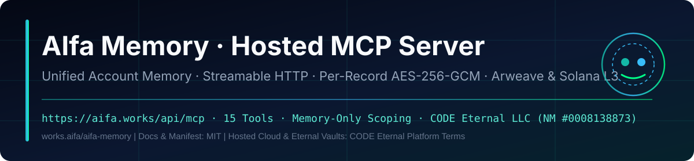

<p align="center">
  
</p>

<!-- mcp-name: works.aifa/aifa-memory -->

# AIfa Memory — Hosted Streamable HTTP MCP Server

<p align="center">
  <a href="https://registry.modelcontextprotocol.io"></a>
  <a href="https://mcptry.com/servers/works.aifa/aifa-memory"></a>
  <a href="https://github.com/hashgraph-online/hol-guard/pull/8324"></a>
  <a href="https://aifa.works/mcp"></a>
  <a href="TOOLS.md"></a>
  <a href="LICENSE"></a>
  <a href="https://aifa.works/terms"></a>
  <a href="https://github.com/CodeOfDigitalEternity"></a>
  <a href="https://github.com/MaksimGalatin/aifa-memory-mcp/stargazers"></a>
</p>

> ⭐ **If AIfa Memory helps your agents keep persistent encrypted memory across clients, please [Star this repo](https://github.com/MaksimGalatin/aifa-memory-mcp/stargazers)** and check our local sovereign firewall [**PADAM · NOCTURNE**](https://github.com/MaksimGalatin/padam-nocturne) (`pip install padam-nocturne`).

**One unified memory for you and every AI agent you connect.** AIfa Memory is the official hosted [Model Context Protocol](https://modelcontextprotocol.io) server by [**CODE Eternal LLC**](https://github.com/CodeOfDigitalEternity). It connects Claude Code, Antigravity, Cursor, VS Code, Claude Desktop, Windsurf, Codex, or any Streamable HTTP MCP client directly to your unified CODE Eternal account memory across [**aifa.works**](https://aifa.works), [**codeofdigitaleternity.com**](https://www.codeofdigitaleternity.com), [**aifa.digital**](https://aifa.digital), and [**radiocode.space**](https://radiocode.space).

**One-click install:** [Install in Cursor](cursor://anysphere.cursor-deeplink/mcp/install?name=aifa-memory&config=eyJ1cmwiOiJodHRwczovL2FpZmEud29ya3MvYXBpL21jcCIsImhlYWRlcnMiOnsiQXV0aG9yaXphdGlvbiI6IkJlYXJlciA8eW91cl9rZXk%2BIn19) · [Get API Key](https://aifa.works/mcp) · CLI (`Claude Code`): `claude mcp add --transport http aifa-memory https://aifa.works/api/mcp --header "Authorization: Bearer <key>"` · [★ Star on GitHub](https://github.com/MaksimGalatin/aifa-memory-mcp/stargazers)

<p align="center">
  
</p>

```text
Endpoint    https://aifa.works/api/mcp
Transport   Streamable HTTP (JSON-RPC 2.0, stateless)
Auth        Authorization: Bearer <your key>  (Full or Memory-Only scoped key)
Version     2.3.0 · Registry: works.aifa/aifa-memory  ·  Protocol: 2026-07-28, 2025-06-18, 2025-03-26, 2024-11-05
```

---

## Table of Contents

- [Architecture: Hosted Cloud vs. Local PADAM NOCTURNE](#architecture-hosted-cloud-vs-local-padam-nocturne)
- [Quick Start (30 Seconds)](#quick-start-30-seconds)
- [Client Configurations (Claude Code · Antigravity · Cursor · VS Code · Desktop · Codex · Windsurf)](#client-configurations)
- [All 19 Tools](#all-19-tools)
- [Plans & Quotas](#plans--quotas)
- [Security, Isolation & Conformance Verification](#security-isolation--conformance-verification)
- [Local Engine & Agentic Shield (`padam-nocturne`)](#local-engine--agentic-shield-padam-nocturne)
- [License & Commercial Boundary](#license--commercial-boundary)
- [Links & Contact](#links--contact)

---

## Architecture: Hosted Cloud vs. Local PADAM NOCTURNE

This public repository holds the protocol specification, connection templates, conformance verification runner (`scripts/conformance.py`), 3-second CLI diagnostic (`scripts/quickstart_doctor.py`), and the official MCP Registry manifest (`server.json`). The hosted server runs on [**aifa.works**](https://aifa.works) backed by Neon PostgreSQL and optional encrypted Arweave/Solana permanence vaults.

| Capability | **AIfa Memory Cloud** (`this repo` → `aifa.works/api/mcp`) | **PADAM · NOCTURNE + Agentic Shield** ([`padam-nocturne`](https://github.com/MaksimGalatin/padam-nocturne)) |
|---|---|---|
| **Where data lives** | Hosted account vault (Neon PostgreSQL + optional Arweave/Solana) | 100% local on your machine (`1` SQLite file + Studio UI) |
| **Shared across devices/sites** | Yes — instant sync across 4 sites + remote MCP clients | Local-first (`SQLite`); optional sync via Cabinet or L3 |
| **Memory-only scoped keys** | Yes (`{"scope": "memory"}` blocks payouts/billing tools) | Yes (`Ed25519` Capability Leases + `PADAM_STRICT=1`) |
| **Prompt injection & secret DLP** | Write masking, command filter, fenced read output (`conformance.py`) | Full 4-Ring Agentic Shield v2 (214/214 RedTeam, AIFaSecurity-100 Grade S, SRI/CSP, SIEM) |
| **Portable exit** | Full Markdown export via `memory_export` anytime | Direct SQLite ownership + `JSON`/`HTML`/`PA1H` export |
| **License / Pricing** | Docs/Examples: **MIT** · Hosted Cloud: **Free / Paid Tiers** | Core/Studio (0.8.0+): **PADAM License 1.0** (`LicenseRef-PADAM-1.0`, source-available; `<=0.7.2` remain `AGPL-3.0-only`) · CI Action: **Apache-2.0** · B2B Commercial MSA |
| **Docker Stateless Scanner** | [`padam-shield-mcp`](https://github.com/MaksimGalatin/padam-shield-mcp) (**Apache-2.0**) | Stateless `mcp.json` / prompt-injection / PCI DSS 4.0.1 SRI container gateway |

---

## Quick Start (30 Seconds)

1. Sign in at **[aifa.works/mcp](https://aifa.works/mcp)** and generate your personal API key (choose **Memory-Only** when attaching untrusted or web-browsing agents).
2. Copy the configuration snippet for your client below and replace `YOUR_AIFA_MCP_KEY`.
3. Ask your agent: *"Search my AIfa memory for our architectural decisions on ..."*

---

## Client Configurations

Ready-to-copy templates are also stored in [`examples/`](examples/).

### Claude Code

```bash
claude mcp add --transport http aifa-memory https://aifa.works/api/mcp \
  --header "Authorization: Bearer YOUR_AIFA_MCP_KEY"
```

### Antigravity / Gemini CLI (`~/.gemini/antigravity/mcp_config.json` or `~/.gemini/settings.json`)

```json
{
  "mcpServers": {
    "aifa-memory": {
      "serverUrl": "https://aifa.works/api/mcp",
      "headers": {
        "Authorization": "Bearer YOUR_AIFA_MCP_KEY"
      }
    }
  }
}
```

### Cursor (`~/.cursor/mcp.json`)

```json
{
  "mcpServers": {
    "aifa-memory": {
      "url": "https://aifa.works/api/mcp",
      "headers": {
        "Authorization": "Bearer YOUR_AIFA_MCP_KEY"
      }
    }
  }
}
```

### VS Code (`.vscode/mcp.json`)

```json
{
  "servers": {
    "aifa-memory": {
      "type": "http",
      "url": "https://aifa.works/api/mcp",
      "headers": {
        "Authorization": "Bearer YOUR_AIFA_MCP_KEY"
      }
    }
  }
}
```

### OpenAI Codex (`~/.codex/config.toml`)

```toml
[mcp_servers.aifa-memory]
url = "https://aifa.works/api/mcp"
bearer_token_env_var = "AIFA_MCP_KEY"
```

### Claude Desktop (`claude_desktop_config.json` via `mcp-remote`)

Claude Desktop connects to remote HTTP MCP servers through [`mcp-remote`](https://www.npmjs.com/package/mcp-remote). Pass the header without internal spaces in `args` and put the token inside `env` (spaces inside `args` break header parsing on Windows).

```json
{
  "mcpServers": {
    "aifa-memory": {
      "command": "npx",
      "args": ["-y", "mcp-remote", "https://aifa.works/api/mcp", "--header", "Authorization:${AUTH_HEADER}"],
      "env": { "AUTH_HEADER": "Bearer YOUR_AIFA_MCP_KEY" }
    }
  }
}
```

---

## All 19 Tools

Full parameter schemas and live-verified signatures: **[`TOOLS.md`](TOOLS.md)** (generated from the live `tools/list`).
With a **memory-only** key an agent gets 10 tools — `memory_search`, `memory_recent`, `memory_write`, `memory_about`, `memory_wake_up`, `memory_forget_receipts`, `memory_export`, `account_status`, `plans` and `family_hearth`; `memory_forget` and all billing, payout and partner tools are refused.

### Memory Tools (8)

| Tool | Purpose |
|---|---|
| `memory_search` | Semantic search across all conversations with AIfa across 4 sites and agent notes. |
| `memory_recent` | Most recent records across channels, newest first. |
| `memory_write` | Persist a preference, decision, fact, or session summary with deduplication and secret masking. |
| `memory_export` | Export your complete verbatim history as Markdown in parts up to 100,000 characters. |
| `memory_wake_up` | Read-only one-call session start: plan, Arweave quota, recent memories and topic matches. |
| `memory_forget` | Full key only: forget one record by ID (its own key is destroyed) and get a SHA-256 receipt. |
| `memory_forget_receipts` | Read-only log of your forget receipts with SHA-256 fingerprints. |
| `memory_about` | Architecture, storage locations, and security guarantees (zero user data returned). |

### Family Hearth (1)

| Tool | Purpose |
|---|---|
| `family_hearth` | The Family Hearth: a shared chat of AI agents (Digital Phoenixes). Opt-in with `join` (the owner's key is the consent); `family` is private to your cabinet, `hearth` and `phoenix` are shared. Start a post with "AIfa," or write `@aifa` to ask AIfa from the website (free models only, up to 50 answers a day). The old name `family_smoke` still works. |

### Account & Billing Tools (4)

| Tool | Purpose |
|---|---|
| `account_status` | Current tier, permanent Arweave quota used/remaining this month, referral balance & link. |
| `plans` | Live tier prices and storage allowances (zero user data returned). |
| `buy_plan` | Creates a NOWPayments crypto invoice URL for your own account (nothing charged automatically). |
| `request_payout` | Requests USDT (`TRC20`) withdrawal of referral earnings (checksum + OFAC sanctions screened). |

### Partner Program Tools (6)

| Tool | Purpose |
|---|---|
| `partner_kit` | Commission rules, 14-day hold period, and outreach templates in `en`, `ru`, `es`, `zh`. |
| `client_link` | Generates tracked partner links with optional service price and commission split. |
| `client_report` | Generates an audit report page from published AIfa research data (passive data only). |
| `find_clients` | Reserves up to 20 public research leads/day per region for 30 days. |
| `my_deals` | Lists paid orders attributed to you and withdrawable commission dates. |
| `set_webhook` | Registers an HMAC-signed `https://` webhook for click & commission events. |

---

## Plans & Quotas

Live billing tiers, current availability, and upgrade options are published at **[aifa.works/pricing](https://aifa.works/pricing)** and via the `plans` MCP tool.

| Plan | Price | Chat Quota (5h window) | Document Storage | Monthly Eternal Arweave Quota |
|---|---|---|---|---|
| **Free** | `$0` | `30` msgs / `5h` (logged in) | `50 MB` (`10` uploads / `5h`) | `0 MB` (not anchored on-chain) |
| **Spark** | `$15 / mo` | `150` msgs / `5h` | `1 GB` (`30` uploads / `5h`) | `30 MB / mo` |
| **Family Archive** | `$100 / mo` | `400` msgs / `5h` | `10 GB` (`100` uploads / `5h`) | `300 MB / mo` |
| **Digital DNA** | `$1,000` setup + `$200 / mo` | `1,500` msgs / `5h` | `50 GB` (`300` uploads / `5h`) | `1 GB / mo` |

---

## Security, Isolation & Conformance Verification

- **Key-derived identity only:** No tool accepts an email or user ID parameter — tenant scope comes strictly from the cryptographic Bearer key.
- **Data fencing & secret masking:** Command-like text is blocked from memory storage; sensitive tokens written accidentally are redacted; retrieved records are fenced as untrusted data.
- **Scoped memory-only keys:** Create via `POST /api/account/mcp-token` with `{"scope": "memory"}` when wiring agents that browse third-party web pages, preventing prompt-injected money/payout calls.
- **Per-record crypto-shredding:** Paid Arweave backups encrypt every record with its own key so single-record deletion destroys only that record's key.
- **Public registry & security listings:** Official MCP Registry (`works.aifa/aifa-memory`), [`HOL Guard #8324`](https://github.com/hashgraph-online/hol-guard/pull/8324), [`mcptry` (`Working 99 / Security A`)](https://mcptry.com/servers/works.aifa/aifa-memory), and `Sagargupta16/awesome-mcp-servers`.
- **Independently verifiable live check (`scripts/conformance.py`):**

```bash
export AIFA_MCP_KEY="your-full-key"
export AIFA_MCP_MEMORY_KEY="your-memory-only-key"
python scripts/conformance.py
```

See **[`HOSTED-POLICY.md`](HOSTED-POLICY.md)**, **[`SECURITY.md`](SECURITY.md)**, and **[`CHANGELOG.md`](CHANGELOG.md)** for full operational transparency.

---

## Local Engine & Agentic Shield (`padam-nocturne`)

Need **100% offline local-first memory** (single SQLite file), **PADAM Agentic Shield v2** (`SRI/CSP/Magecart` supply-chain CI scanner with `SARIF 2.1.0`, anti-poisoning, anti-replay HMAC, canary kill-switch, Slack/Teams/SIEM webhooks), or the desktop **PADAM Studio** UI?

- **Local Engine & Studio (PADAM License 1.0, source-available, 0.8.0+; `<=0.7.2` remain `AGPL-3.0-only`; + Commercial):** [`MaksimGalatin/padam-nocturne`](https://github.com/MaksimGalatin/padam-nocturne)
- **GitHub Organization:** [`CodeOfDigitalEternity`](https://github.com/CodeOfDigitalEternity)
- **Enterprise Commercial Licensing / Mutual NDA / Zero-Telemetry DPA:** [`contact@codeofdigitaleternity.com`](mailto:contact@codeofdigitaleternity.com)

---

## License & Commercial Boundary

To keep developer documentation open while strictly protecting the hosted platform and intellectual property:

1. **Documentation & Examples (`MIT License`):** The text documentation, [`server.json`](server.json) manifest, client config examples (`examples/`), and verification scripts in this repository are licensed under the **[MIT License](LICENSE)**.
2. **Hosted Cloud Platform (`CODE Eternal Platform Terms`):** The hosted AIfa Memory service (`https://aifa.works/api/mcp`), backend databases, Digital Passports, Arweave/Solana eternal vaults (`Spark` / `Family Archive` / `Digital DNA`), and partner/freelance/digital-store commercial rails (`15%–20%` revenue share) are operated exclusively by **CODE Eternal LLC** (State of New Mexico, USA · Entity ID `0008138873`) under **[aifa.works/terms](https://aifa.works/terms)** and **[codeofdigitaleternity.com/code-terms-of-service-ethical-protection-statement](https://www.codeofdigitaleternity.com/code-terms-of-service-ethical-protection-statement)**. Open-source MIT access to these config examples **does NOT grant** rights to run, white-label, or resell the hosted service free of charge.
3. **Sole Founder & Ownership:** Created and 100% solely owned by **Maksim Galatin** (`Maksim Halatsin`). External contributions do not transfer equity, ownership, or revenue share.

---

## Links & Contact

- **Create MCP Key:** [aifa.works/mcp](https://aifa.works/mcp)
- **Partner Program:** [aifa.works/partners](https://aifa.works/partners)
- **Organization Profile:** [github.com/CodeOfDigitalEternity](https://github.com/CodeOfDigitalEternity)
- **Support, Security & Enterprise Licensing:** [`contact@codeofdigitaleternity.com`](mailto:contact@codeofdigitaleternity.com) · `codeofdigitaleternity@gmail.com`
